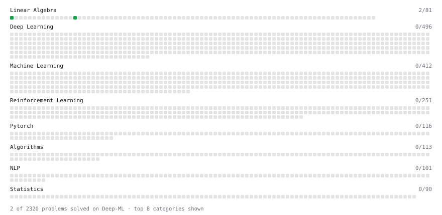

# Deep-ML

My machine learning practice from [Deep-ML](https://www.deep-ml.com). Every solution here was written by hand.

**4** solved · 3 problems · 0 labs · 1 math

[**Browse the interactive portfolio**](https://AdiyaPremjit.github.io/deep-ml/) to replay this filling in over time.

## Problems

| | Difficulty | Solved | |
| --- | --- | --- | --- |
| [Convert Vector to Diagonal Matrix](https://www.deep-ml.com/problems/35) | easy | 2026-11-18 | [solution](problems/0035-convert-vector-to-diagonal-matrix) |
| [Matrix-Vector Dot Product](https://www.deep-ml.com/problems/1) | easy | 2026-11-17 | [solution](problems/0001-matrix-vector-dot-product) |
| [Graph Auto-Encoder: GCN Encoder, Inner-Product Decoder and Reconstruction BCE](https://www.deep-ml.com/problems/1901) | medium | 2026-11-21 | [solution](problems/1901-graph-auto-encoder-gcn-encoder-inner-product-decoder-and-reconstruction-bce) |

## Math

| | Difficulty | Solved | |
| --- | --- | --- | --- |
| [Vector Operations](https://www.deep-ml.com/math-problems/7) | easy | 2026-11-17 | [solution](math/0007-vector-operations) |

---

_This file is regenerated by Deep-ML on every push._
